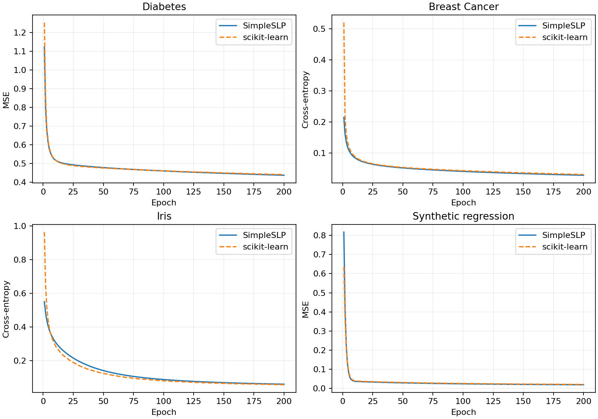

# Neural Network with One Hidden Layer

This project implements two neural networks in NumPy. `SimpleSLPClassifier` predicts class labels, and `SimpleSLPRegressor` predicts continuous values. Both provide `fit`, `predict`, and `score`. The classifier also provides `predict_proba`, with one column per class in `classes_` order.

## Installation and usage

```bash
python -m pip install -r requirements.txt
python -m pytest -q
python demo.py
```

The demo prints the test scores and saves the training loss curves to `loss_curves.png`.

## How the network works

For a mini-batch of $m$ samples, the hidden layer computes $Z_1=XW_1+b_1$ and applies an activation function to produce $A_1=f(Z_1)$. The available activations are sigmoid, tanh, ReLU, and identity. The output layer computes $Z_2=A_1W_2+b_2$. The output activation and loss depend on the task.

| Task | Output activation | Loss |
| --- | --- | --- |
| Binary classification | Sigmoid returns the probability of the second class | Binary cross-entropy |
| Multiclass classification | Softmax returns class probabilities that sum to 1 | Multiclass cross-entropy |
| Regression | Identity returns the computed value directly | Mean squared error (MSE) |

Backpropagation starts with the gradient of the loss with respect to $Z_2$. For classification, it is $D_2=(P-Y)/m$, where $P$ contains the predicted probabilities and $Y$ contains the encoded targets. For regression with $q$ outputs, it is $D_2=2(\hat{Y}-Y)/(mq)$. The hidden-layer gradient is $D_1=(D_2W_2^\top)\odot f'(Z_1)$. The weight gradients are $X^\top D_1$ and $A_1^\top D_2$. Each bias gradient is the sum of its layer's gradients over the samples in the mini-batch.

At each epoch, the training samples are shuffled and processed in mini-batches. NumPy computes the gradients for a full batch at once. With `batch_size=1`, each update uses one sample. With `batch_size=None`, each update uses the whole training set. Momentum carries forward a fraction of the previous parameter update. With `momentum=0`, each update subtracts the gradient multiplied by the learning rate.

With `early_stopping=True`, the model holds out part of the training data for validation. Training stops after `n_iter_no_change` consecutive epochs without a validation loss improvement greater than `tol`. The model restores the parameters from the epoch with the lowest validation loss. For regression, the model standardizes the targets using the samples used for parameter updates and converts predictions back to the original scale.

For numerical stability, softmax subtracts the largest logit for each sample before exponentiating. The training cross-entropy is computed directly from the logits to keep the loss numerically stable when predicted probabilities are close to 0 or 1.

## Demo and results

Each experiment holds out 25% of the data for testing and uses a random seed of 42. The Breast Cancer and Iris splits preserve class proportions. Features are standardized using statistics from the training split. Both implementations use one hidden layer with 24 units, tanh activation, a batch size of 16, and 200 epochs, with momentum and early stopping disabled. For regression, the demo doubles the scikit-learn learning rate to account for its half-MSE convention. Each implementation initializes its weights according to its own rules. [scikit-learn MLP documentation](https://scikit-learn.org/stable/modules/neural_networks_supervised.html)

| Dataset | Test metric | SimpleSLP | scikit-learn |
| --- | --- | ---: | ---: |
| Diabetes | R² | 0.4991 | 0.5000 |
| Breast Cancer | Accuracy | 97.20% | 97.20% |
| Iris | Accuracy | 94.74% | 94.74% |
| Synthetic regression | R² | 0.9756 | 0.9721 |



Accuracy is the fraction of samples classified correctly. An R² of 1 indicates perfect predictions. The implementations achieved similar scores on all four datasets in this train/test split. The Diabetes R² of about 0.50 indicates that roughly half of the variation in the test targets remains unexplained.

The curves show training loss. SimpleSLP recomputes it using the weights at the end of each epoch. Scikit-learn aggregates the mini-batch losses as the epoch progresses. The regression plots report MSE on standardized targets.

## Oral exam questions

- **Why use a nonlinear hidden activation?** A composition of affine transformations is still affine. A nonlinear activation lets the network learn patterns such as XOR.
- **What does a binary output of 0.8 mean?** The model estimates a probability of 0.8 for the second class in `classes_` and 0.2 for the first.
- **Why hold out a test set?** The model fits its weights and computes standardization statistics without using the test samples. The test score measures performance on unseen data.
- **What do finite differences check?** The test perturbs each weight and bias slightly, measures the change in loss, and compares the resulting numerical gradient with the gradient from backpropagation.
